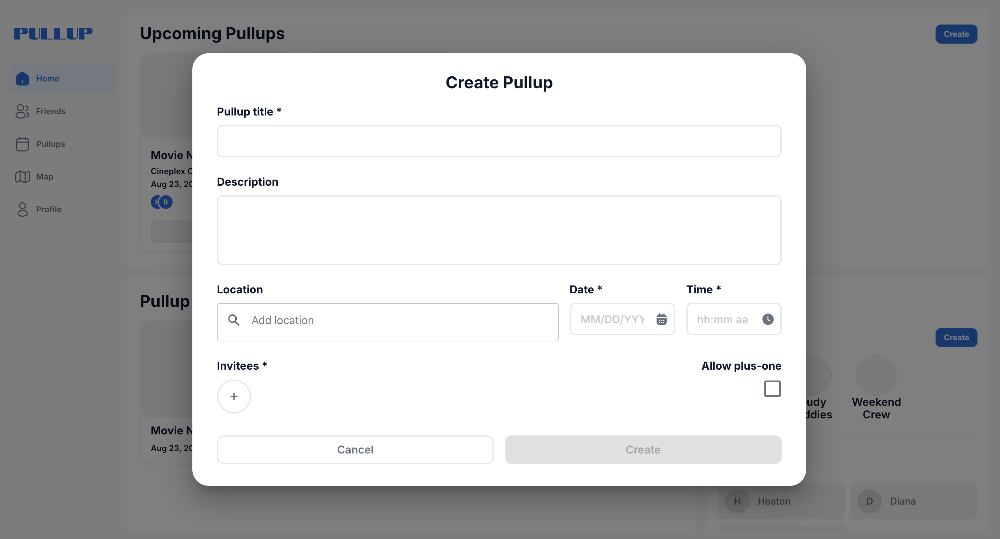
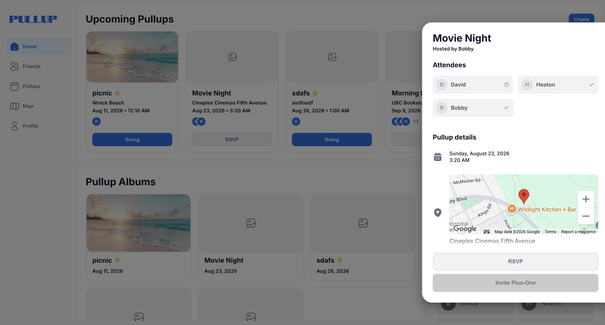
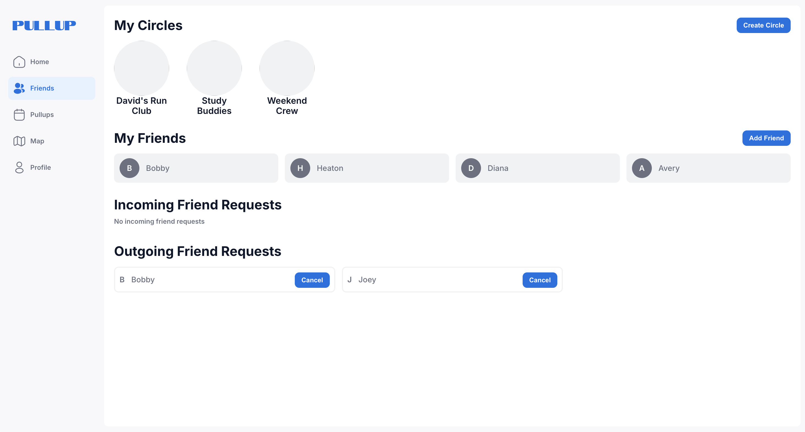
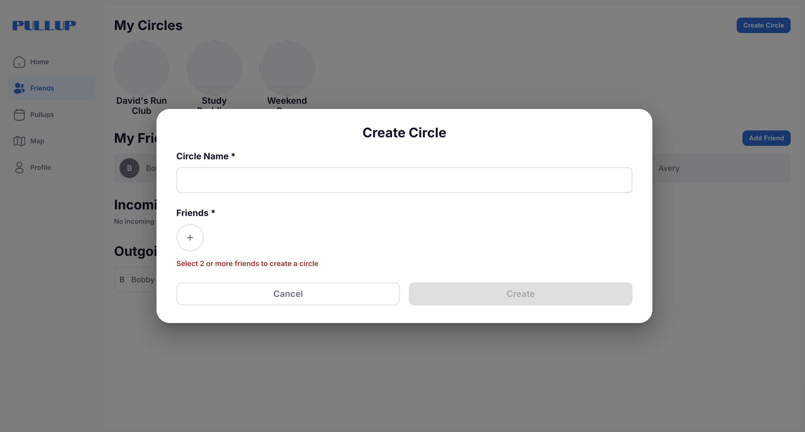
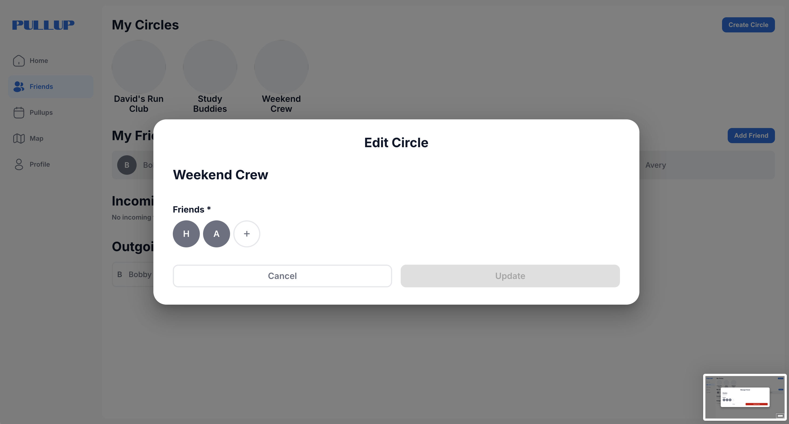
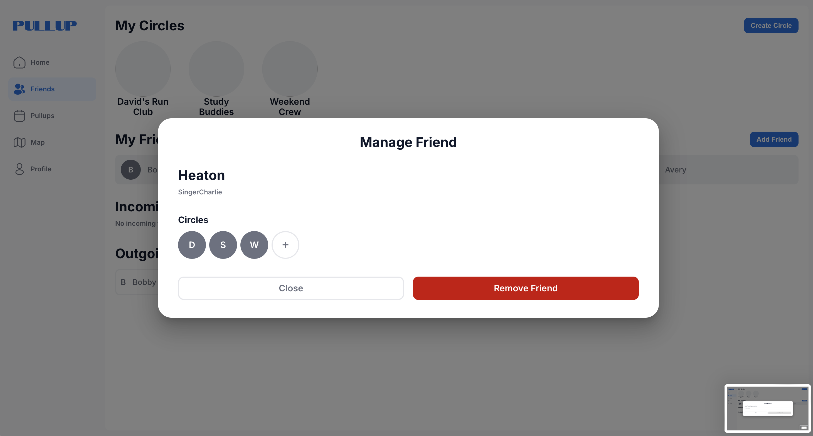
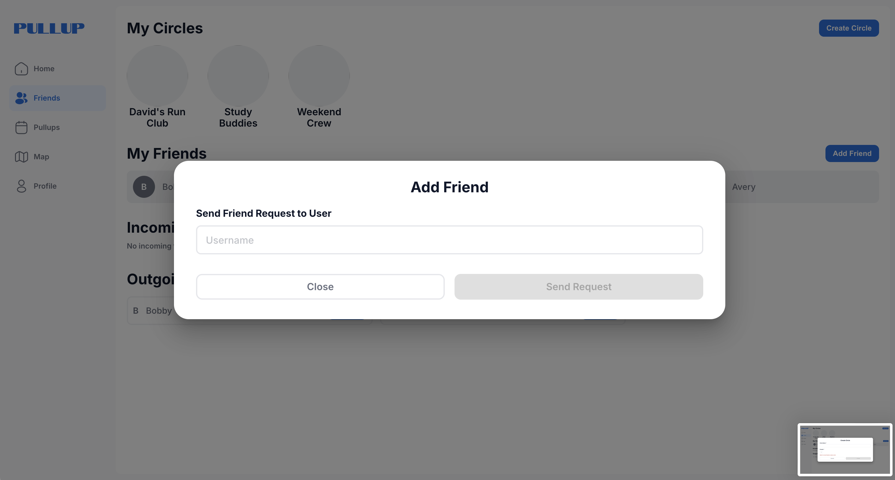
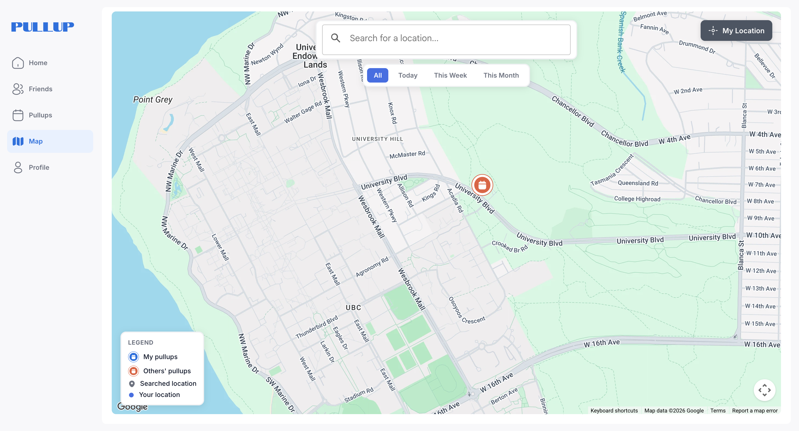
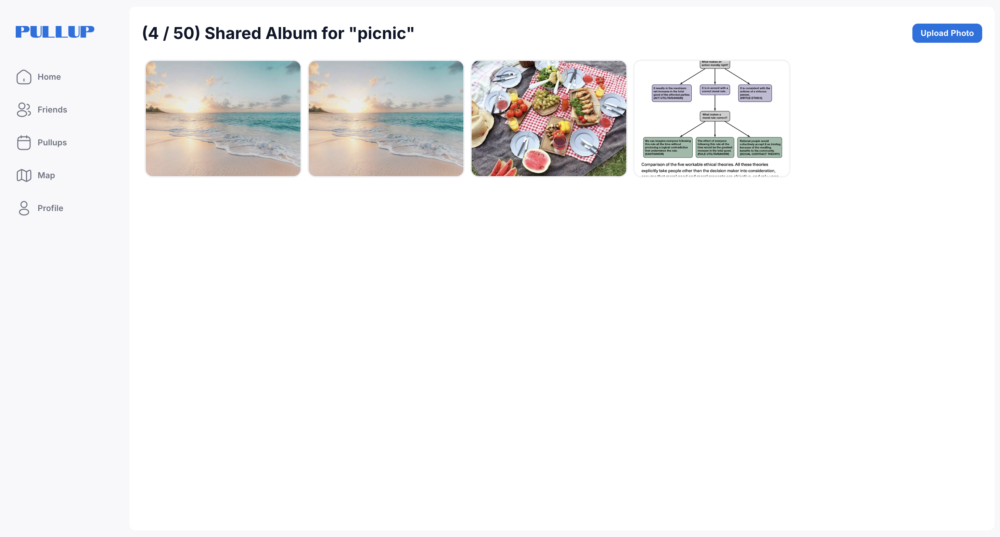

> **Note:** Source code is kept in a private repository in accordance with group privacy policies. Code samples and walkthroughs are available upon request

# Video Demo
- https://youtu.be/xjQ-A7j23hc

# What is Pullup?
PullUp is a social hangout app designed for the fast moving and spontaneous generation of gen-z and millennials. Existing event planning apps like Facebook Events, Bounce, etc. have heavyweight processes for creating events that are public facing and end up getting lost in peoples feeds. As a result, when people want to create plans & events with friends they are forced to individually DM friends or text across different groupchats/apps to share their plans. PullUp solves this problem allowing users to quickly create and share plans between multiple people on a single platform.

# Team Members
| Name | Role |
| --- | --- |
| Heaton | Fullstack developer |
| Daniel | DevOps Lead |
| Molly | Frontend Lead |
| David | QA Lead |
| Jake | Backend Lead |

# My Contributions
1. Feature ownership of the shared album feature
    - End-to-end implementation for this entire feature
    - Configured AWS S3 storage with granular IAM least-privilege policies and CORS rules to ensure secure client-side uploads 
    - Presigned URL for photo upload and download from the browser
    - Engineered privacy pipeline that strips sensitive GPS/device EXIF metadata from uploaded images while retaining dateTaken timestamps for chronological ordering
    - Implemented client-side browser caching strategies for static image assets, reducing `GET` requests to S3 and speeding up subsequent page load times on cache hit
1. Finalize project tech stack and architecture
    - Analyze trade-offs amongst our shortlist of technology and choose the best options for our project
1. RESTful API design
    - Wrote the specification for the REST API endpoints our frontend would depend on
1. Implement backend API routes
    - Owned API routes for the `/pullup` and `/photo` endpoints
1. Project Management
    - I led team meetings to make sure we hit project milestones

# Core Features
## 1. Create and share a pullup
Invite friends and/or circles, set time and optional location (Places autocomplete), toggle plus-ones, and publish. The creator is the logged-in user.

## 2. Pullup detail — host and attendee
Open a card for details, map link when location exists, RSVP, host **Edit** (fields, invitees, location), and host **Delete**.

## 3. Friends and social circles
Send/accept friend requests; create, edit, and delete circles; manage membership — then reuse circles when inviting to a pullup.

## 4. Map of upcoming hangouts
The map view plots the user’s upcoming pullups that have locations, with Today / This Week / This Month filters and place search powered by the Google Places API.

## 5. Shared album / Photo Timeline
From Home → Pullup Albums → upload JPEG/PNG (≤5 MB), view, download, delete, and react on photos stored in S3.

Photos are ordered in ascending order of `dateTaken`. This information is parsed from the EXIF metadata when available, with the upload time used as the fallback value.

Can upload up to 5 photos at a time to prevent one user from uploading to the max 50 per album at once. This also protects our server and S3 from being overwhelmed by large payloads. 

